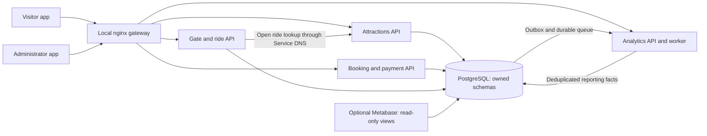

# Wonderland: cloud-native booking and analytics platform

SE6020 — Architecting Enterprise Cloud Solutions / Cloud Computing  
Technical report for the implemented local MVP and prepared cloud architecture  
Evidence date: 15 October 2026; viva date supplied for this project: 8 November 2026

**Status:** the application is implemented locally. The local infrastructure evidence records measured results. AWS deployment, managed authentication/hosting, external payment delivery and remote CI are explicitly separate verification gaps. This report requires the student's review, screenshots and submission details before academic submission.

## 1. Objective and requirements

Wonderland needs a visitor-facing attraction catalogue and ticket booking system, together with administrator controls and visibility into park activity. The official assignment is the primary requirements source [1]. Its visitor requirements include authentication/profile, attraction suitability, one ticket tier per booking, visit date/time, secure payment, a reference or QR ticket, and owned history. Administrator requirements include attraction and price management plus visitor/ride analytics. The required reports cover daily arrivals, tickets and revenue by tier, popular attractions, and busiest/quietest hours.

The assignment also assesses microservices, containers, Kubernetes and a gateway, persistent data, a web interface, managed cloud authentication/hosting, monitoring visualization, Infrastructure as Code and repository integration. These requirements are mapped individually in [requirements traceability](requirements.md), with all seven rubric weights and live acceptance gates in [current assignment coverage](coverage.md). A successful local demonstration does not establish all cloud assessment requirements.

The project uses the uploaded lectures/labs as supporting sources, particularly cloud design patterns [2], Docker [3], and Kubernetes [4–5]. The assignment remains authoritative where implementation convenience differs from its expectations. Its page 3 cloud-specific automation wording and page 4 allowance for CloudFormation or Terraform should be clarified with the lecturer before relying on Terraform alone for the live AWS assessment.

## 2. Scope and user experience

The MVP has two independent React/TypeScript entry points: a visitor app and an administrator app. Both reuse shared API/component code. The visitor can browse without authentication, then sign in, select a tier/party/date/slot, create a booking, confirm a simulated payment, and view a signed QR ticket and history. Profile and visit history are available under My account.

The administrator can create/update/retire attractions, manage database-stored tiers/prices, admit a paid booking by reference or signed QR content, record ride usage for a checked-in party, and view reports. The reference shortcut resolves the booking into its signed ticket through an administrator-protected booking endpoint; gate still verifies that ticket and enforces the visit date and full party count. It does not bypass payment or signature verification.

The simple launcher starts native PostgreSQL, the APIs and both apps in one terminal. A separate command performs the Kubernetes infrastructure rehearsal. Complex operator commands remain inside scripts and optional technical guides rather than the primary demonstration instructions. The walkthrough is [the short demo guide](../local/demo.md); infrastructure commands are in [the local infrastructure guide](../local/kubernetes.md).

## 3. Implemented architecture

The system separates catalogue, booking/payment/profile, gate/ride operations and reporting into four deployable services. PostgreSQL stores separate owned schemas, with restricted service roles. This balances independent application deployment against local operational simplicity. A shared database instance remains an explicit failure domain; this is not a database-per-service or highly available production design.

This diagram describes local Kubernetes. Native development uses Vite's local proxies instead of nginx. Native and cluster databases/credentials are separate. Metabase is verified against the native database and is started with `./start.sh monitoring`; it does not automatically query cluster records.

The selected smaller AWS target runs K3s Kubernetes, PostgreSQL and Metabase on one Free-plan-eligible 8 GiB x86 EC2 server (`m7i-flex.large`), with separate Amplify visitor/admin websites, Cognito, SQS, ECR, Secrets Manager, CloudWatch application logs and AWS API Gateway. The gateway forwards over verified HTTPS to a protected public-IP origin; internal services and PostgreSQL also use verified TLS. Administration and Metabase use private SSM access. The server was provisioned on 16 October 2026; K3s reports Ready, SSM is online, both Amplify websites are published, and Cognito email signup/confirmation/login passed. Application image publication and integrated cloud verification remain in progress. EKS/private RDS/private ALB/IRSA remain an optional advanced design, not the selected deployment. Additional architecture diagrams and trade-offs are in [architecture](../architecture/overview.md) and [decisions](../architecture/decisions.md).

## 4. Data integrity and booking lifecycle

Ticket tiers and prices are stored in PostgreSQL. Initial prices are Individual USD 40, Couple USD 75, Family USD 140 and Group USD 165, with guest limits enforced by the backend. Administrators can change these records. Each booking retains the tier/price snapshot used at creation, so subsequent price edits do not rewrite historical purchases. Money is represented as integer cents.

A booking begins pending. User-bound idempotency keys and payload fingerprints protect retries: the same command reuses its result, while conflicting reuse is rejected. Confirmation checks a verified provider event against the stored checkout, amount and currency, then updates booking/payment/outbox state transactionally. The local payment simulator exercises a signed server event through the verification path without contacting a payment provider. The Stripe test adapter has offline request/signature/circuit-breaker tests; actual external checkout and webhook delivery remain unverified.

Tickets use an RSA signature. Booking holds the private signing key; gate receives the public key and an opaque ownership-tag key. Admission requires a valid signed ticket for today's Asia/Colombo visit date and the entire booked party. A unique reference prevents a second arrival. Ride recording requires today's arrival, a count within party size and a currently open attraction verified through a bounded catalogue request. Stable ride event identifiers protect retries. Visitor history is filtered by verified ownership rather than user-provided owner parameters.

Normal booking rules reject past dates, dates more than 365 days ahead and elapsed same-day slots. The local demo launcher explicitly permits today's elapsed slots to allow an evening rehearsal; dates, payment, identity and admission checks remain enforced. Demo mode cannot be enabled with cloud/non-local identity settings. This exception must not be described as normal production booking behavior.

## 5. Reporting and design patterns

Operational changes write outbox events with the business transaction. The local worker moves them into a durable PostgreSQL queue and projects purchases, arrivals and rides into reporting facts. Source acknowledgement/queue insertion and fact/deduplication/completion each have atomic transaction boundaries. Invalid work retries with backoff and reaches a stored dead-letter state after the configured limit. Reporting is eventually consistent: a successful operation can precede its updated chart/table.

The five required metrics are calculated from stored facts, not fabricated chart series. Local purchases/arrivals are demonstration data, not real park statistics. Arrivals sum actual admitted guests; ticket counts count purchased bookings; revenue uses confirmed cents; attraction popularity sums riders; hourly arrivals include zero-filled operating-hour buckets. Daily/hourly boundaries use Asia/Colombo, and the provisional operating window is 09:00–18:00. Outside-hours arrivals remain in daily totals and are identified separately. Equal counts share busiest/quietest ranks.

| Pattern | Implementation and reason | Limit |
|---|---|---|
| CQRS/read model [2, pp8–14] | Validated operational writes feed separate reporting facts/views | Shared physical database; eventual report lag |
| Service discovery [2, pp21–22] | Gate addresses catalogue through stable Kubernetes Service DNS | Cluster DNS/network dependency |
| Circuit breaker [2, pp23–24] | Bounded Stripe-adapter retries and closed/open/half-open behavior | Per-process state; real provider operation pending |
| Gateway [2, pp25–27] | Local nginx routes browser requests to internal APIs | Actual AWS API Gateway remains unverified |
| Health checks [2, pp36–37] | Liveness separates process state from database/schema readiness | Shared DB failure affects several ready states |
| Transactional outbox/idempotency | Commit business state and durable work together; deduplicate repeated events | At-least-once delivery is not exactly-once transport |

Metabase uses a restricted BI role with access to reporting aggregate views. The local monitoring launcher verifies all seven saved SQL questions, and source/report reconciliation has passed. The native development metadata store uses H2 and must not be presented as a production metadata deployment. The optional cloud metadata design uses separate PostgreSQL ownership, with real deployment pending.

## 6. Security boundaries

Local sign-in verifies generated private passwords with salted scrypt hashes and issues one-hour signed access tokens. Roles and subjects come from server configuration, not the login request. Wrong-portal accounts are rejected. The visitor bundle excludes the administrator dashboard, but security does not depend on that separation: every protected API independently checks the role and booking/history endpoints enforce ownership. Local password login is bounded per process and is explicitly prohibited outside local/test identity configuration.

Browser sessions keep tokens in memory and clear on refresh/sign-out. Private credentials, ticket keys, local databases and course PDFs are ignored by Git. Request logging uses sanitized route templates/request IDs rather than body, token, secret or URL query content. Only booking receives the private ticket key and payment secrets; other services have separately scoped database roles. Local pods use non-root identities, read-only root filesystems, dropped capabilities, bounded resources and no automatic API token mount.

Local loopback HTTP and single-node Kubernetes Secrets are development boundaries, not proof of production TLS or encryption at rest. The selected AWS configuration adds encrypted EBS/S3/SQS, verified PostgreSQL and service TLS, managed secrets, a bounded EC2 runtime IAM role and Cognito verification. Pods share that node role within one trust domain; this is not per-pod IRSA. The advanced design separately prepares RDS/IRSA. Actual AWS permissions, TLS delivery, identity lifecycle and leakage review must be demonstrated before making production claims.

## 7. Infrastructure and reproducibility

A named Colima VM hosts a named Minikube cluster using a dedicated private kubeconfig. The local helper rejects non-local targets. PostgreSQL uses a persistent volume; deployment waits for database readiness and a versioned migration Job before rolling out APIs. Locally reused image tags are followed by rollout restarts so updated code and Secrets reach running pods.

The catalogue has two baseline replicas and an HPA bounded to three using CPU utilization. Real HTTP catalogue load is used for the scaling demonstration. Blue and green deployments use the same domain artifact with distinct version metadata to demonstrate atomic Service selection and rollback; this is not a new-feature rollout. Failure tests restore worker/database/deployment baselines and retain measured outcomes, including failed attempts.

Terraform now has five roots. The selected simple root provisions the no-domain EC2/K3s topology; four optional advanced roots retain state bootstrap, identity/hosting/registry, EKS/RDS and private gateway-edge infrastructure. The simple cloud wrapper automates bootstrap, image publication, database migration, workloads, hosting and verification after a reviewed saved plan. Local private Terraform state requires a secure backup. A live read-only plan succeeded with 45 creations and no deletions; offline validation/mock checks passed for all five roots. The reviewed deployment permissions are installed and actual provisioning succeeded. The observed m7i-flex.large compute quote is $0.09576/hour before storage/IPv4/service usage. Six-hour auto-stop and explicit stop/start limit compute runtime, while retained resources can still consume credits. Neither stop nor a Free-plan credit balance proves zero cost.

## 8. Testing and evidence

Application tests cover real PostgreSQL transactions, concurrent booking/event behavior, authorization/ownership, signature validation, price snapshots, projection/deduplication/permissions, cloud configuration guards and handover privacy. Both visitor/admin builds are type-checked. Local HTTP scenarios exercise actual API/proxy/database interactions rather than only mocked domain responses.

The single infrastructure-test command runs four offline Terraform roots, actual image builds/deployment, business integration, pod replacement, blue-green rollback, worker interruption/catch-up, database readiness/PVC recovery, HPA load and final report/source reconciliation. The authoritative measured record is [local infrastructure evidence](../results/evidence/local-infrastructure.json). Its timestamps, step status, elapsed time and explicitly public observations come from execution; private raw logs remain outside the handover.

One rehearsal exposed metrics-server sampling lag after a pod replacement. The failed result was preserved, the baseline restored, and autoscaling was changed to wait a bounded interval for metrics before starting load. A second attempt served 45,064 successful requests with no failures and reached three ready pods, but an assertion rejected the lagging HPA current-replica field. The assertion was corrected to require an HPA scale-up request together with actual ready Deployment capacity. Both attempts are preserved; only a fully successful retry establishes a passing suite. Exact request throughput is a measurement for this Mac, not a production capacity promise.

The final local rehearsal passed all **14 stages**, including **46,964 successful catalogue requests with zero failures** and HPA scale **2 → 3 → 2**. Scale-up was observed after the load sampling window; the deployment's ready count and the HPA request provided the scale-up evidence. The current application/packaging suite passed **149 tests with no skips** and both frontend builds passed. One existing Starlette TestClient deprecation warning remains. These results describe the local run, not cloud throughput or managed-service verification.

The Git remote is configured and a read-only SSH HEAD query succeeded. The CI definition runs tests, builds, offline Terraform checks, container checks and a source-only handover artifact. Remote source publication and a successful workflow run still require observed evidence. Manual browser appearance, screenshots and the student's timed explanation remain personal review tasks.

## 9. Limitations and assessment readiness

The local MVP demonstrates the core visitor/admin flows and local orchestration. It deliberately excludes cancellation/refunds, partial arrival, re-entry, production capacity controls and ticket revocation policies. The shared database, single-node cluster and per-process authentication throttling are not production high availability or distributed security controls. Report lag, certificate rotation and retention need operational policies before production.

The Phase 7 AWS rehearsal remains pending; the local rehearsal is development/testing evidence only. The selected K3s/PostgreSQL host is one failure domain. A pod HPA does not provide node autoscaling or reduce the EC2 hourly rate. Cloud concurrent booking/check-in, event-burst handling and individual-service failure recovery must still be demonstrated; production seasonal capacity and whole-host/database high availability are not claimed. Phase 8 has a report, source evidence and a viva script, with academic review, public repository access, remote CI, hosted integrations and submission still pending. The user-requested Phase 9 adds a clean handover archive and restart/stop commands; no earlier roadmap definition of Phase 9 is implied.

Cold shutdown/restart also preserved eight confirmed bookings and their matching purchase facts; the existing administrator password remained valid. Repeated stop is harmless, even after Minikube clears its kubeconfig entries. See [local handover evidence](../results/evidence/local-handover.json).

The handover command packages source and public documentation with file hashes and an archive checksum. It excludes credentials, database state, installed dependencies, build output and private course material, even if an excluded path was accidentally tracked. It refuses recognized private-key/live-credential material. This is a bounded packaging safeguard, not a universal secret-scanner guarantee.

## 10. References and acknowledgement

[1] SLIIT, *Assignment — Cloud Computing 2026 — AUG*, supplied course document, pp1–4. Primary functional requirements, tasks and assessment weights. Original retained privately.

[2] SLIIT, *Lecture 4 — Cloud Design Patterns*, supplied slides: CQRS pp8–14; discovery pp21–22; circuit breaker pp23–24; gateway pp25–27; health checks pp36–37. Pattern selections are explained in [design patterns](../architecture/patterns.md).

[3] SLIIT, *Lab 5 — Introduction to Docker*, supplied practical material. Supporting containerization context.

[4] SLIIT, *Lab 7 — Stepping into K8s*, supplied practical material. Supporting Kubernetes workload/service context.

[5] SLIIT, *Lab 8 — K8s Deep Dive*, supplied practical material. Supporting orchestration/recovery context.

[6] SLIIT, *SE6020 module outline*, supplied course document. Learning outcome and individual assessment context.

Implementation evidence: [source/test guide](../local/testing.md), [architecture decisions](../architecture/decisions.md), [local infrastructure commands](../local/kubernetes.md), [cloud runbook and its primary technical references](../advanced/eks-runbook.md), and the timestamped local evidence record.

OpenAI Codex assisted implementation, testing and drafting. The student must personally review the report, understand and explain the code, verify the lecturer's acknowledgement policy, add required personal/submission details and acknowledge other help accurately. No assistance acknowledgement or machine-generated report substitutes for individual understanding or submission approval.
